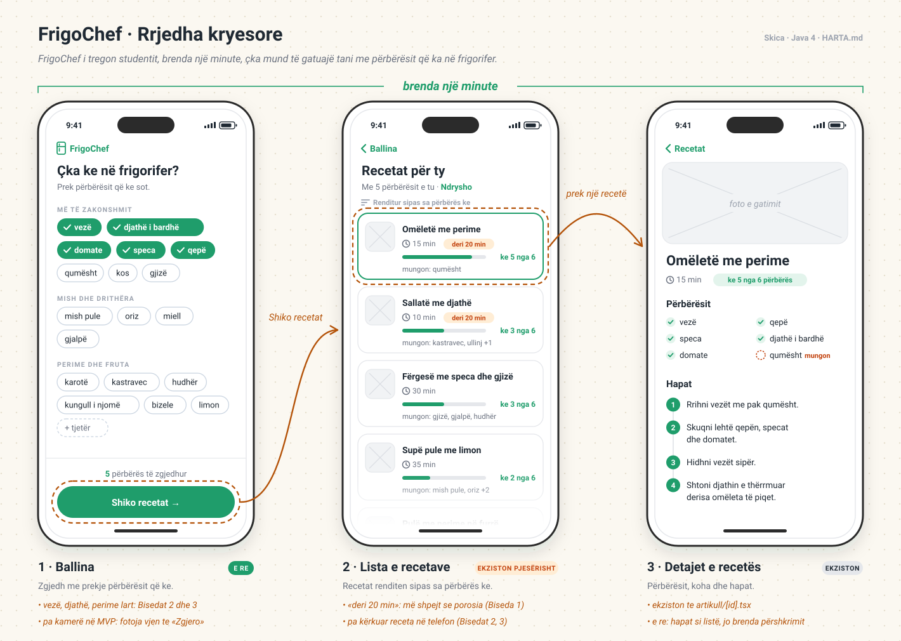

# Harta · FrigoChef

## Puna e vetme
FrigoChef i tregon studentit, brenda një minute, çka mund të gatuajë tani me përbërësit që ka në frigorifer.

## Rrjedha kryesore
1. **Ballina: "Çka ke në frigorifer?"** · Përdoruesi zgjedh me prekje përbërësit që ka. *E re:* sot Ballina (`projekti-im/src/app/index.tsx`) e tregon direkt listën e recetave.
2. **Lista e recetave** · Recetat që përputhen me përbërësit e zgjedhur, të renditura sipas sa përbërës ke. *Ekziston pjesërisht:* lista me `FlatList` dhe `Kartela` është te `projekti-im/src/app/index.tsx`, por i tregon të gjitha recetat, pa filtrim dhe pa renditje.
3. **Detajet e recetës** · Përbërësit, koha dhe hapat. *Ekziston* te `projekti-im/src/app/artikull/[id].tsx`; hapat sot janë brenda përshkrimit si tekst.

## Brenda / jashtë (MVP)

### Brenda
- **Zgjedhja e përbërësve** · Bisedat 1, 2 dhe 3: të tre kishin ushqim në frigorifer, por nuk dinin çka të bënin me të. Në të tria bisedat, një pjesë e ushqimit u prish.
- **Lista e recetave sipas përputhjes** · Biseda 3: problemi është të gjesh shpejt diçka që përputhet me atë që ke. Biseda 2: kërkimi i recetave në telefon e lodhi aq sa hoqi dorë.
- **Detajet e recetës** · Biseda 1: FrigoChef duhet t'i japë një recetë. Bisedat 2 dhe 3: të dy kërkuan receta në telefon.
- **Receta të shpejta (deri në rreth 20 minuta)** · Biseda 1: alternativa, porosia, zgjat 30–50 minuta pritje. Biseda 2: 20–30 minuta të humbura duke menduar dhe duke pritur ushqimin. Biseda 3: rreth 20 minuta duke menduar e kërkuar.
- **Përbërës të zakonshëm si vezë, djathë, perime** · Bisedat 2 dhe 3: kishin pothuajse të njëjtat përbërës, dhe aplikacioni duhet t'i njohë mirë kombinimet e thjeshta.

### Jashtë (për më vonë)
- Foto e frigoriferit me AI (vjen te faza "Zgjero", javët 9–12). Në MVP përbërësit zgjidhen me prekje, që ta testojmë së pari nëse recetat e duhura e zgjidhin problemin.
- Lista e blerjeve
- Kaloritë dhe dietat
- Komentet dhe vlerësimet

## Skicat

Ekranet veç e veç: [1 · Ballina](docs/skica/1-ballina.svg) · [2 · Lista e recetave](docs/skica/2-lista.svg) · [3 · Detajet e recetës](docs/skica/3-detajet.svg)
